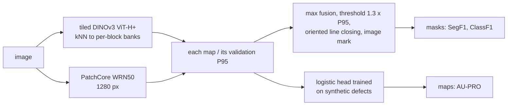

# MVTec Visual Inspector

[](https://github.com/ThanhDatVN/MVTec-Visual-Inspector/actions/workflows/ci.yml)


Industrial surface-defect **detection and localization learned from defect-free images only**
(one-class anomaly detection). The project evaluated each method under a protocol fixed before the
results, tested on three datasets, and finished with two submissions to MVTec's held-out benchmark
server. Everything ran on a laptop GPU with 4 GB of memory.

**Final result (MVTec AD 2, held-out splits, scored by MVTec's server):**

| system | AU-PRO@0.05 private / mixed | SegF1 private / mixed | ClassF1 private / mixed |
|---|---|---|---|
| v1: PatchCore, WRN50, 640 px (first submission) | 37.64 / 35.11 | 26.42 / 23.01 | 73.91 / 76.21 |
| **v6: tiled DINOv3 ViT-H+ + WRN50, learned-head maps (final)** | **62.97 / 60.73** | **53.76 / 51.67** | **79.28 / 79.45** |

v6 equals the VAND 3.0 challenge winner on SegF1 (ISVL, 53.81 / 51.43) and is 3–4 points below the
VAND 4.0 winner (SuperADD, 57.42 / 54.35). Under the changed lighting it loses the least SegF1 of
the published systems. It met the bar written down before the upload on both splits:
+10 AU-PRO, +20 SegF1, and no ClassF1 loss over v1.


**Start here:** [reports/00-final-report.md](reports/00-final-report.md) is the technical report:
method, every experiment, figures and analysis. [reports/README.md](reports/README.md) is the
experiment register. [docs/](docs/README.md) holds the research documents: protocol, metrics,
decision log, pre-registered experiment plan, review, and open problems.

---

## What the project found

1. **A recipe frozen on three VisA categories held on data that shaped nothing.** PatchCore at
   640 px with a fixed 10k memory bank scores image AUROC **0.981** on nine held-out VisA categories
   ([E12](reports/09-visa-confirmation.md)) and **0.943** on MPDD, another factory and camera
   ([H1](reports/10-mpdd-transfer.md)). Both tests were pre-registered.
2. **The same recipe collapses on MVTec AD 2** (AUROC 0.685, at chance on two categories;
   [E13](reports/11-ad2-confirmation.md)). The false alarms come from **changed light
   direction and colour**, not exposure. Five photometric remedies, few-shot adaptation and DINOv2
   features did not fix it ([E14–E20](reports/12-ad2-lighting-and-resolution.md)).
3. **Localization was rebuilt metric by metric** ([E21–E23](reports/13-ad2-localization-and-server.md)):
   - tiled DINOv3 ViT-H+ nearest-neighbour maps fused with WRN50 at 1280 px;
   - one global mask rule with oriented line closing and an image mark;
   - a small per-category head trained on synthetic defects for the continuous maps.

   Development AU-PRO went from 0.351 to 0.587 and SegF1 from 0.205 to 0.609.
4. **Threshold-free metrics transferred from development to the server; tuned thresholds did
   not.** AU-PRO came out 2 points *above* its development estimate. SegF1 came out 8–9 points
   below, because the mask rule was chosen on `test_public` ([analysis](reports/00-final-report.md#62-thresholds-where-development-optimism-lives)).
5. **The operating point breaks long before the ranking does.** Under blur or over-exposure the
   false-alarm rate reaches 45–100% while AUROC drops by about 0.04. Input guards refuse those
   images ([E08](reports/05-robustness.md)).
6. **A 1% false-alarm target is often not achievable.** A threshold from `n` validation normals
   cannot promise less than `1/(n+1)`. Thresholds use a conservative rank, and an unattainable
   request is relaxed and flagged, never silently missed ([P2](reports/01-evaluation-apparatus.md)).
7. **41 negative results are documented** with their evidence
   ([14-negative-results.md](reports/14-negative-results.md)).

## How the final system works



Training-free retrieval on frozen backbones: no network is trained, except a four-feature
logistic head per category. Details and design reasons are in
[final report §4](reports/00-final-report.md#4-the-final-system-v6) and §6.

## Repository layout

```text
docs/                   research documents: protocol, metrics, decision log (ADR-1..17), experiment plan
reports/                00-final-report.md, numbered per-experiment reports, run registry, study tables, figures
src/inspector/          the package
  data/                 dataset layouts, splits, integrity checks, transforms, synthetic defects
  models/               trivial floors, autoencoder, PatchCore, tiled DINOv3 kNN, anomalib reference
  metrics/              AU-PRO, pixel and image metrics, ranking statistics
  postproc/             conservative thresholds, MaskRule binarization, object regions
  robustness/           the corruption suite
  api/, app/            FastAPI service with input guards; Gradio demo
  runner.py, cli.py     the shared runner (run identity, resume) and the `inspector` command
configs/                data, model and recipe YAML (a run = data + model + recipe overlay)
scripts/                study, analysis and export scripts, named <stage>_<experiment>_<topic>.py (scripts/README.md)
tests/                  unit, property, leakage and license-guard tests (no data or GPU needed)
notebooks/              generated drivers for the laptop and Kaggle sessions
```

## Getting started

```bash
python -m venv .venv                                       # everything installs into the venv
.venv/Scripts/python -m pip install torch torchvision --index-url https://download.pytorch.org/whl/cu126
.venv/Scripts/python -m pip install -e ".[notebook,dev]"

pytest                                                     # no GPU, no dataset: fixtures are procedural

inspector fetch visa --out data/raw                        # 1.93 GB, no account
inspector audit -c configs/data/visa_pcb1.yaml --data-root data/raw/VisA_20220922
inspector run   -c configs/data/visa_pcb1.yaml -c configs/recipes/confirmation-v1-patchcore-640.yaml \
                --data-root data/raw/VisA_20220922 --categories pcb1 --seeds 0 1 2
inspector results                                          # regenerate reports/results_registry.csv
python scripts/report_figures.py                      # regenerate the report figures
```

The MVTec AD 2 pipeline (fetch, export, the v6 build) is in
[final report §9](reports/00-final-report.md#9-reproducing-the-results).

## Serving

A fitted detector is exported as an **artifact**: the memory bank, plus a `meta.json` that holds
the hyperparameters, the input transform, the threshold frozen on validation normals, and
provenance. No pickle is used. The service never re-derives the threshold.

```bash
inspector export -c configs/data/visa_pcb1.yaml -c configs/recipes/confirmation-v1-patchcore-640.yaml \
                 --data-root data/raw/VisA_20220922 --category pcb1 --out artifacts/pcb1
inspector serve  --artifact artifacts/pcb1            # FastAPI: GET /health, POST /predict[?heatmap=true&explain=true]
inspector demo   --artifact artifacts/pcb1            # Gradio (needs the [serve] extra)

docker build -t mvi-inspector .
docker run --rm -p 8000:8000 -v "$PWD/artifacts/pcb1:/artifact:ro" mvi-inspector
```

`/predict` returns:

- the score and the decision: `normal`, `anomalous`, or `refused` when the exposure or focus
  guards find the input outside the training range;
- the threshold and the false-alarm bound it was calibrated to;
- the location of the map's peak, and the latency;
- optionally, a heat-map overlay on a fixed colour scale.

`explain=true` names the nearest normal training patch to the peak.

The v1 recipe answers in **99 / 102 ms** (p50 / p95) on an RTX 3050 with 0.6 GB of GPU memory, and
in 890 / 957 ms on the CPU. Intended use and limitations are in [MODEL_CARD.md](MODEL_CARD.md).

## Notebooks

| notebook | venue | covers |
|---|---|---|
| [`01_laptop_data_and_eda.ipynb`](notebooks/01_laptop_data_and_eda.ipynb) | laptop, 4 GB | acquisition, integrity audit, EDA, Tier 0 floors, development PatchCore |
| [`02_kaggle_experiments.ipynb`](notebooks/02_kaggle_experiments.ipynb) | Kaggle T4 | reference config, ablation sweep, Gate E follow-up, autoencoder, anomalib comparison, MPDD |

Both are generated by `scripts/report_build_notebooks.py` and never hand-edited. They are thin drivers:
they install the package and call its API.

## Compute

| where | hardware | used for |
|---|---|---|
| laptop | RTX 3050 4 GB, Ryzen 5 6600H, 16 GB RAM | all AD 2 work, including the DINOv3 ViT-H+ export (~9.5 h for eight categories) |
| Kaggle | Tesla T4 16 GB | VisA ablation sweep, autoencoder, anomalib comparison, MPDD |

## License and attribution

Code: MIT ([LICENSE](LICENSE)). The datasets are **not** redistributed:

- VisA: CC BY 4.0.
- MPDD and MVTec AD 2: CC BY-NC-SA 4.0, used for non-commercial evaluation only.

No dataset image, anomaly map or mask is in this repository. A CI job scans the whole git history
for dataset bytes. The report figures plot metrics only. Attribution and obligations:
[ATTRIBUTION.md](ATTRIBUTION.md), [NOTICE](NOTICE).

Third-party comparators come from [anomalib](https://github.com/open-edge-platform/anomalib) and
are labelled `owner=lib` in every table. The DINOv3 component reimplements SuperADD from its paper;
no code was copied.

## Citation

See [CITATION.cff](CITATION.cff).
