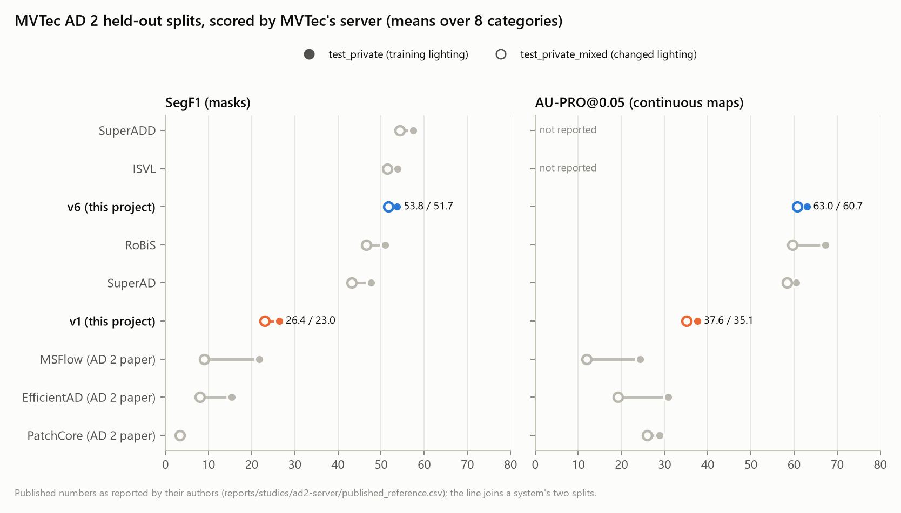
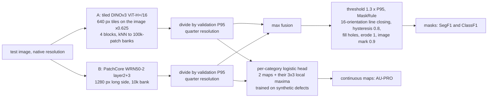
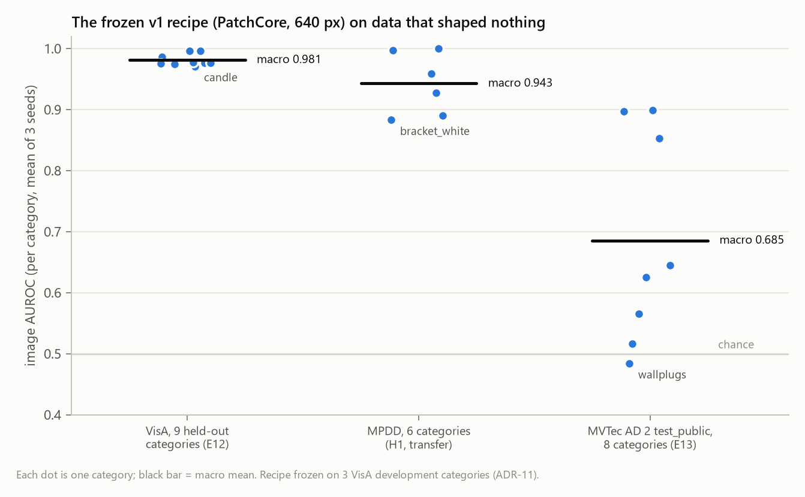
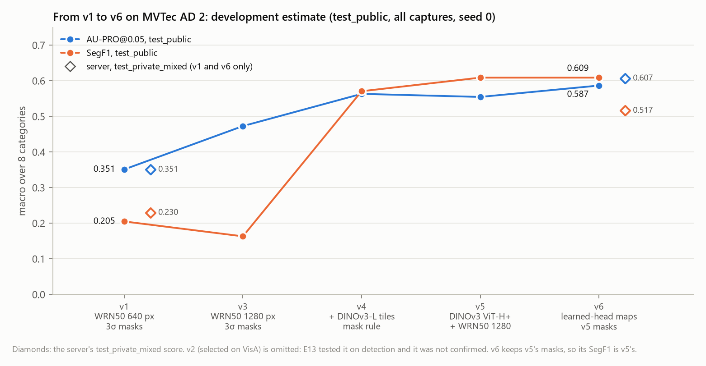
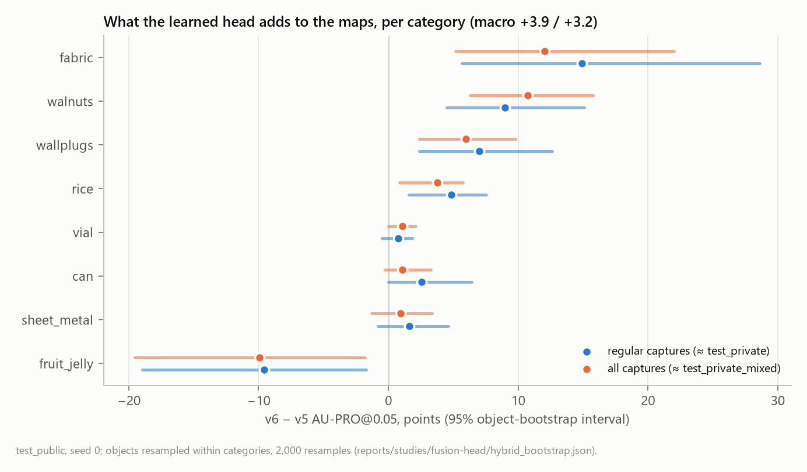
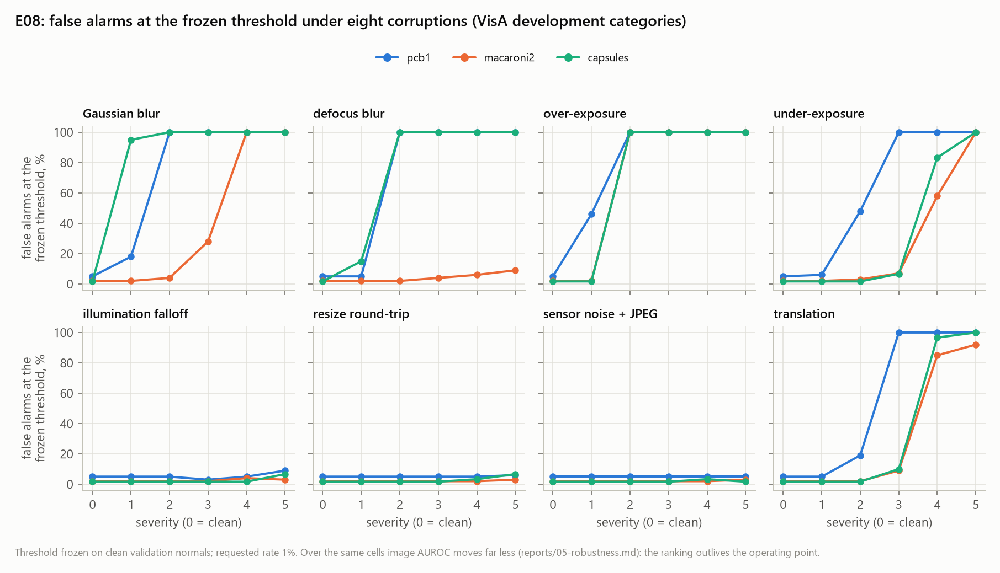
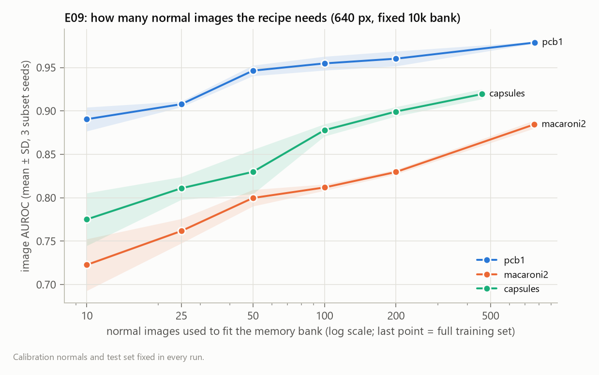
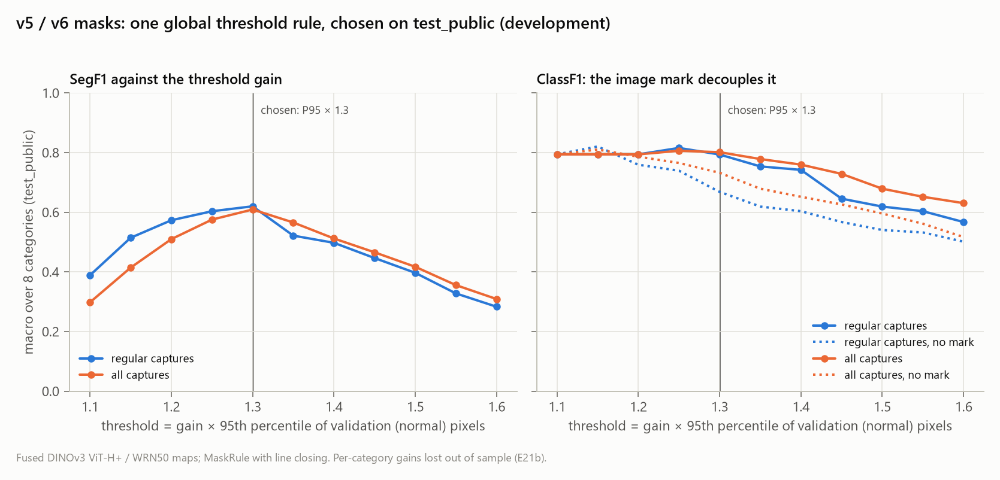
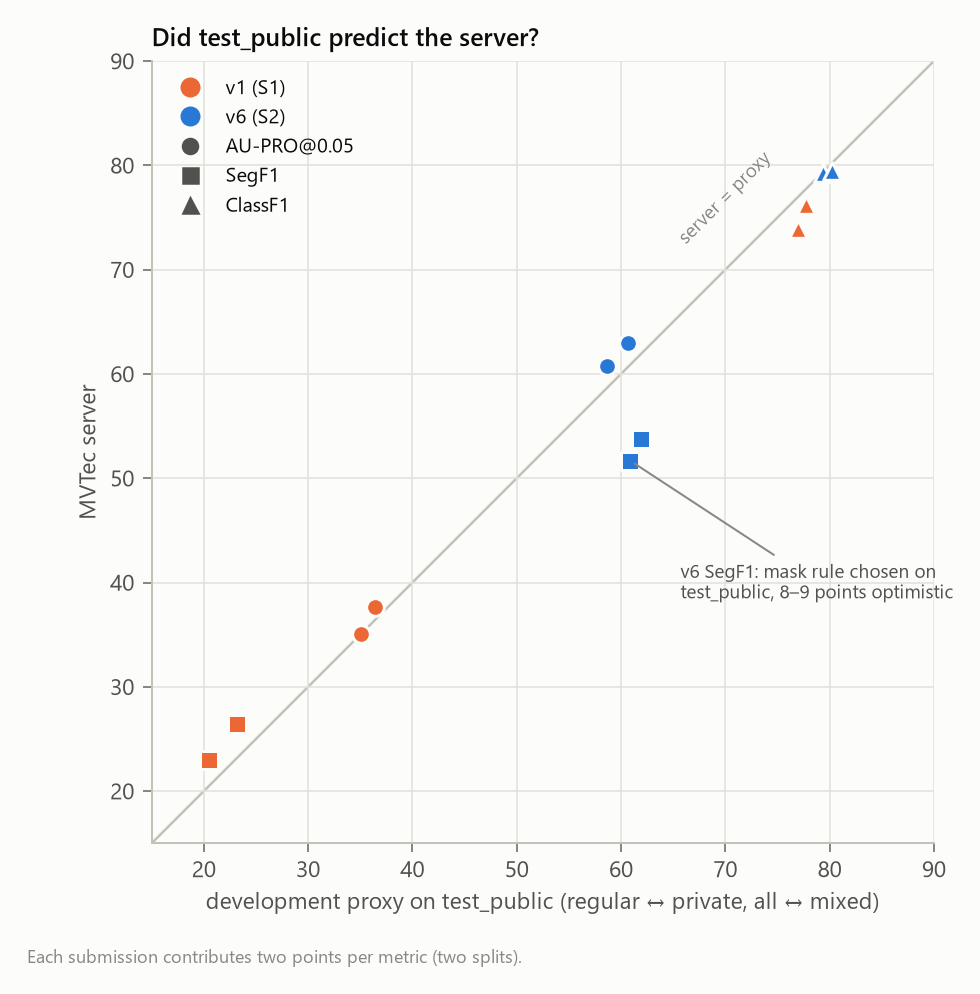

# MVTec Visual Inspector — final technical report

One-class industrial defect detection and localization: models fitted on defect-free images only,
evaluated under a protocol fixed before the results, and finished with two submissions to MVTec's
held-out benchmark server. This report is the single entry point. It summarizes every experiment,
explains the final system, and analyzes what the numbers do and do not show. The per-experiment
reports it links to hold the details and the raw tables.

**Result.** The final system, **v6**, scores AU-PRO@0.05 **62.97 / 60.73**, SegF1 **53.76 /
51.67** and ClassF1 **79.28 / 79.45** on MVTec AD 2 `test_private` / `test_private_mixed`, the
splits only MVTec's server can score. That is 25 AU-PRO points and 27–29 SegF1 points above the
project's first submission (v1). It meets the pre-registered bar (H5) on both splits. Its SegF1
equals that of the VAND 3.0 challenge winner and is 3–4 points below the VAND 4.0 winner. The
system was built and run on a laptop GPU with 4 GB of memory.

| | AU-PRO@0.05 private / mixed | SegF1 private / mixed | ClassF1 private / mixed |
|---|---|---|---|
| v1: PatchCore, WRN50, 640 px (S1, 2026-10-13) | 37.64 / 35.11 | 26.42 / 23.01 | 73.91 / 76.21 |
| **v6: tiled DINOv3 ViT-H+ + WRN50, learned-head maps (S2, 2026-10-15)** | **62.97 / 60.73** | **53.76 / 51.67** | **79.28 / 79.45** |



*Figure 1. Server results on the two held-out splits. Filled dot: `test_private`, the training
lighting. Hollow dot: `test_private_mixed`, changed lighting. The project's two submissions are in
colour. Published numbers are as their authors report them
([studies/ad2-server/published_reference.csv](studies/ad2-server/published_reference.csv)).*

Datasets: VisA © Amazon (CC BY 4.0), MPDD (CC BY-NC-SA 4.0), MVTec AD 2 © MVTec Software GmbH
(CC BY-NC-SA 4.0). No dataset image, anomaly map or mask is in this repository. Every figure here
plots metrics only. See [ATTRIBUTION.md](../ATTRIBUTION.md).

---

## Contents

1. [Problem and constraints](#1-problem-and-constraints)
2. [Data and protocol](#2-data-and-protocol)
3. [Metrics](#3-metrics)
4. [The final system (v6)](#4-the-final-system-v6)
5. [Results, in the order they were obtained](#5-results-in-the-order-they-were-obtained)
6. [Technical analysis](#6-technical-analysis)
7. [What did not work](#7-what-did-not-work)
8. [Limitations and open problems](#8-limitations-and-open-problems)
9. [Reproducing the results](#9-reproducing-the-results)
10. [Appendix A: identifiers used in code and reports](#appendix-a-identifiers-used-in-code-and-reports)
11. [Appendix B: per-category tables](#appendix-b-per-category-tables)

---

## 1. Problem and constraints

**Task.** A model is fitted on images of normal parts only. At test time it returns an image score
`s(x)` and a pixel map `m(x)`. It also returns an operating decision: either an image threshold,
or a binary mask for the AD 2 server. Defects are not seen in training. This is the cold-start
setting of a new production line, where defective samples are rare and of unknown kinds.

**Constraints that shaped every design choice.**

| constraint | consequence |
|---|---|
| Laptop GPU: RTX 3050, **4 GB** VRAM, 16 GB RAM; Kaggle T4 for batch studies | Training-free retrieval models (memory-bank kNN) and frozen backbones. Bounded-memory feature paths. ViT-7B-class models are out. |
| MVTec data is CC BY-NC-SA 4.0 | No dataset bytes in git: a CI job scans the **whole history**. No published image or overlay. Maps stay local. |
| Small calibration sets (8–136 normals per category) | Thresholds from a conservative rank with an explicit floor `1/(n+1)` (ADR-7, ADR-9). Never a nominal 1% that cannot be met. |
| Two server submissions in total | Every claim about held-out data was pre-registered: the decision rule was committed and pushed before the run. Development data are labelled as such. |

**No accuracy target.** Targets chosen before the achievable range is known are guesses. The
project instead fixed *decision rules* in advance: when a change is adopted and when a hypothesis
counts as confirmed.

## 2. Data and protocol

| dataset | role | categories | what it tests |
|---|---|---|---|
| **VisA** | development: `pcb1`, `macaroni2`, `capsules`; confirmation: the 9 others | 12 | Selecting the recipe, then confirming it once on categories that shaped nothing (E12) |
| **MPDD** | transfer probe | 6 painted metal parts | Another camera, factory and annotation team, with the recipe unchanged (H1) |
| **MVTec AD 2** | `test_public`: development; `test_private` / `test_private_mixed`: held out, scored by MVTec's server | 8 | Real lighting shift, thin defects on multi-megapixel images, transparent and reflective parts |

**Roles are fixed before inspection (protocol v2, ADR-10).** Development data may be looked at as
often as needed, and every number from it is labelled *development*. Confirmation data are run
once, under an analysis script and a decision rule that were committed before the run. Once used,
a held-out set is *spent*: it becomes development data for everything that follows. VisA's
confirmation categories, MPDD and AD 2 `test_public` are all spent. AD 2's private splits were
spent by the two server submissions.

**What AD 2 `test_public` contains** (found while working on E14). It shows each object under the
training lighting (`regular`) and under changed captures: `over` / `under` exposure and `shift_k`,
a moved light direction and colour. The training and validation sets contain `regular` captures
only. So `test_public` restricted to `regular` approximates `test_private`, and all its captures
together approximate `test_private_mixed`. All captures of one object are one sample: AD 2
intervals resample **objects**, not images (D2).

**Leakage rules, each enforced by a test** (L1–L7): no file in two splits, checked by SHA-256 of
the bytes; no test image in any fitted parameter; maps never normalized with test statistics;
thresholds from validation normals only, except a labelled oracle; no transform statistic fitted
on test data; a near-duplicate audit between train and test (A4); and no code path that reads
labels of the private splits.

## 3. Metrics

| metric | definition | role |
|---|---|---|
| **Image AUROC** | ROC-AUC of the image score | Detection ranking, threshold-free |
| **FPR / recall at OP-FPR1** | Realized false-alarm rate and recall at the threshold `k = floor(α(n+1))`-th highest validation score, decision `s > τ` (strict); an unattainable `α` is relaxed to `1/(n+1)` and flagged | The operating point a line would actually run |
| **AU-PRO@0.05** | Area under the per-region-overlap curve up to 5% pixel false-positive rate, normalized. Each connected defect counts equally, whatever its size | The AD 2 localization metric; scored on the continuous maps |
| **SegF1** | F1 of the binary masks against ground truth, over all pixels of a category pooled, normal images included | Whether the masks are usable; the server's ranking metric |
| **ClassF1** | F1 of the image decision "the mask is not empty" | The server's image-level metric; scored on the masks |

**The AD 2 server proxy.** `scripts/server_proxy.py` and `scripts/ad2_e21_mask_rules.py`
recompute the server's metrics on `test_public`, with `regular` captures as the private proxy and
all captures as the mixed proxy. It was checked against both submissions (§6.4).

**Statistics.** Three seeds where the method is stochastic. Paired bootstrap intervals, resampled
within class and, on AD 2, by object. Holm correction within a pre-declared family. The
evaluation code was validated first (Gate G2, [P2](01-evaluation-apparatus.md)): a random map gives
AU-PRO@0.05 = 0.025 = L/2, perfect and inverted maps give 1 and 0 exactly, and our PatchCore
reproduces anomalib v2.3.0's patch scores to float32 tolerance (E00).

## 4. The final system (v6)



**Component A: tiled DINOv3** (`src/inspector/models/tiled_knn.py`; after SuperADD, reimplemented
from the paper, with no code copied). DINOv3 ViT-H+/16 from timm, frozen. Each image is scaled by
0.625 and covered by overlapping 640 px windows. Patch tokens from four blocks are each compared
with a per-block memory bank of 100k training patches, density-subsampled. Brightness copies at
0.8–1.2 are added to the bank. Distances are divided by the feature dimension and averaged over
the blocks. Engineering details that mattered:

- DINOv3 overflows fp16 (NaN from the first blocks on real images). The backbone runs in bf16, with
  an overflow guard.
- An axis only one token longer than a tile was covered by two near-identical windows. Using one
  window whenever the axis fits in tile + 2 × overlap halved the cost.
- Distances are computed in chunks of 1,024 queries.

Final cost: ~2 s per image, 2.7 GB VRAM peak.

**Component B: PatchCore WRN50** (`src/inspector/models/patchcore.py`). WideResNet50-2 layer2 +
layer3 features, locally aggregated. A coreset memory bank of 10k patches, nearest-neighbour
distance, Gaussian smoothing. At 1280 px (long side), one feature cell covers ~14 native pixels,
against ~25 px for a DINOv3 token at 0.625 scale. This is why B keeps the hair-thin defects that A
misses.

**Fusion.** Each component's map is divided by the 95th percentile of its own validation pixels at
quarter resolution, and the two are combined by maximum (`scripts/ad2_e21_fusion.py`). The maximum
keeps each component's strong categories. Mean fusion lost 0.03 AU-PRO.

**Masks** (`src/inspector/postproc/binarize.py`, `MaskRule`):

1. Threshold at 1.3 × the validation P95, one global gain for all categories.
2. Line closing at 16 orientations with radius 26 px at quarter resolution, dilating with a 3 px
   line and eroding with a 1 px one. A 1 px scratch at an angle between two sampled orientations
   still bridges.
3. Keep only pixels above 0.8 × the threshold (hysteresis).
4. Fill holes, then erode 1 px.
5. The **image mark**: if the mask is empty but the map exceeds 0.9 × the threshold, set one
   quarter-resolution pixel at the maximum. This decouples ClassF1 from SegF1.

All thresholds come from validation (normal) images only.

**Learned head for the continuous maps** (E23, `scripts/ad2_e23_fusion_head.py`). Per category:

1. Both components are fitted on seven eighths of `train/good`.
2. The held-out eighth, each image also with three synthetic defects
   (`src/inspector/data/synthetic_defects.py`: value-noise blobs filled with displaced texture of
   the same image, and thin strokes), gives labelled pixels.
3. A logistic regression on four features turns the two normalized maps into a defect
   probability. The features are the two maps and their 3×3 local maxima.

The server scores maps (AU-PRO) and masks (SegF1, ClassF1) from separate files. So v6 submits the
head's maps with v5's masks: the head ranks pixels better, and the fixed rule thresholds them
better (§6.3).

**Building the submission.** `scripts/server_export_submission.py` (recipe
`configs/recipes/candidate-v5-fusion.yaml`) fits each category, writes the native-resolution
float16 maps and PNG masks, and keeps the per-component maps. `scripts/server_export_v6_hybrid.py`
then writes v6's maps from the kept component maps on the CPU, and copies v5's masks byte for
byte. MVTec's `check_and_prepare_data_for_upload.py` checked the result (8,180 files). The
archive's SHA-256 is recorded in
[studies/s1-submission/](studies/s1-submission/v6-hybrid-head-maps-v5-masks.json).

## 5. Results, in the order they were obtained

### 5.1 VisA: a recipe, frozen and confirmed (E00–E12)

On three development categories (E00–E04), the largest effect was **input resolution**. From 320
to 640 px, PatchCore's image AUROC rises 0.946 → 0.977 (`pcb1`), 0.702 → 0.890 (`macaroni2`) and
0.661 → 0.910 (`capsules`). A memory bank fixed at 10k entries costs nothing measurable. At 320 px,
PatchCore was not measurably better than linear PCA on two of three categories. The from-scratch
convolutional autoencoder stayed 0.17–0.67 AUROC behind and closed that rung (K1).

The recipe (PatchCore, WRN50 layer2+3, 640 px, 10k bank) was frozen with its analysis (ADR-11) and
run once on the nine untouched VisA categories ([E12](09-visa-confirmation.md)):

- macro image AUROC **0.981** (0.971–0.996 per category);
- AU-PRO@0.05 0.766;
- **H2 confirmed 9/9**: +0.167 [+0.145, +0.189] over the linear floor;
- **H1 not confirmed**: 640 px over 320 px helped on 4/9 categories against a rule of 6, because
  most held-out categories were already at 0.96–0.99 at 320 px;
- the threshold held its bound on 8/9 categories.

Development had overestimated the resolution effect because its categories were the hard ones
(D1).



*Figure 5. The frozen recipe on three held-out datasets, one dot per category. Near ceiling on
VisA, still ≥ 0.88 per category on MPDD, and at chance on two AD 2 categories.*

### 5.2 MPDD: transfer (H1)

Same recipe, other camera, other factory (ADR-12; [report](10-mpdd-transfer.md)):

- macro image AUROC **0.943**, AU-PRO@0.05 0.861, ≥ 0.88 on every category; pixel PCA scores
  0.729;
- MPDD's 8–43 calibration normals cannot support a 1% operating point. The bounds relax to
  2.3–11.1%, and the pooled false alarms (31 against 28.4 expected) match them.

### 5.3 MVTec AD 2: the recipe breaks, and why (E13–E20)

**E13** ([report](11-ad2-confirmation.md), pre-registered in ADR-13) tested a
VisA-selected candidate (v2: `layer2`, 960 px) against v1. The candidate was **not confirmed**:
+0.004 macro AUROC. More importantly, both recipes collapse on AD 2:

- macro image AUROC 0.685, at chance on `can` and `wallplugs`;
- 160 and 195 false alarms against 29 expected.

**E14–E20** ([report](12-ad2-lighting-and-resolution.md)) took the failure apart:

- The false alarms are the **shift** captures, a moved light direction and colour: 22.8% of those
  normals alarm, against 5–6% for exposure changes. Exposure is not the problem.
- Five photometric remedies were tested against pre-registered carry rules and none carried:
  per-image gain, per-image standardization, an exposure-augmented bank, flat-field normalization,
  and a relit bank. A moved specular highlight is neither a gain nor a smooth field.
- A few normals under the new lighting (E16) halve those false alarms at the old threshold, from
  41 to 19 of 187. At a recalibrated threshold they buy no recall (E17): on `can`, changed-light
  normals and defects are not separable with these features.
- DINOv2 features (E18) gained on `rice` but cost `vial` −0.17 and doubled the shift false alarms.
- Resolution is the lever that works (E19). At 1280 px `sheet_metal` goes from 0.63 to 0.86 image
  AUROC, and `fabric`'s AU-PRO from 0.15 to 0.52. Applied to every category (v3), it costs `vial`
  0.14, so the pre-registered gate kept v3 off the server (ADR-14, E20).

**S1.** v1 was submitted as frozen: AU-PRO 37.64 / 35.11, SegF1 26.42 / 23.01. That is above
every baseline of the AD 2 paper, which ran all methods at 256×256, but about half of the
challenge systems.

### 5.4 Localization rebuilt metric by metric (E21–E23)

([report](13-ad2-localization-and-server.md)) The server ranks by SegF1 and AU-PRO. Both depend on the map
first, so the map was rebuilt before the mask:

| step | change | AU-PRO@0.05 (`test_public`, all) | SegF1 |
|---|---|---|---|
| v1 | WRN50 640 px, 3σ masks | 0.351 | 0.205 |
| v3 | WRN50 1280 px, 3σ masks | 0.473 | 0.163 |
| v4 | + tiled DINOv3-L, max fusion, MaskRule, gain 1.25, mark 0.9 | 0.564 | 0.571 |
| v5 | ViT-H+ in place of ViT-L, gain 1.3 (E21b, ADR-16) | 0.555 | **0.609** |
| **v6** | v5 masks; maps from the learned head (E23, ADR-17) | **0.587** | 0.609 |



*Figure 2. Development estimates (seed 0, all captures of `test_public`), with the server's mixed
split as diamonds for the two submitted systems. v3's SegF1 drops because the fixed 3σ rule
breaks on skewed maps (B3). That is what the mask study fixed.*

Between v4 and v6, several more ideas were tested and rejected:

- **E21b:** per-category thresholds lost **−0.024 SegF1 out of sample** in a split-half test over
  objects, so one global gain was kept. Mask-shape variants all landed within ±0.01. A third model
  was unstable. DINOv3 at native resolution cost 2.5× for nothing once fused.
- **E22:** three post-processing ideas of our own, all negative (§7).
- **E23:** a five-input head (all four DINOv3 blocks and WRN50) reached 0.647 / 0.624 AU-PRO, but
  failed its pre-registered per-category guard (`vial` −0.055 against −0.05 allowed). The
  two-input head met its rule and became v6.



*Figure 3. AU-PRO gain of v6's maps over v5's, with 95% object-bootstrap intervals. Seven
categories gain; `fruit_jelly` loses ten points.*

### 5.5 The server's verdict (S2)

v6 was uploaded once. Against the pre-registered H5 bars (AU-PRO ≥ v1 + 10, SegF1 ≥ v1 + 20,
ClassF1 not below v1, on both splits):

| | private | mixed | bar | met |
|---|---|---|---|---|
| AU-PRO@0.05 | +25.33 | +25.62 | +10 | yes |
| SegF1 | +27.34 | +28.66 | +20 | yes |
| ClassF1 | +5.37 | +3.24 | ≥ 0 | yes |

Against published systems (Figure 1):

- **SegF1** equals ISVL, the VAND 3.0 winner (−0.05 / +0.24). It is above RoBiS (+2.8 / +5.2) and
  SuperAD (+6.0 / +8.5), and below SuperADD, the VAND 4.0 winner, by 3.7 / 2.7.
- **AU-PRO** on the private split is between SuperAD (60.51) and RoBiS (67.25). On the mixed split
  it is above both.
- **The changed lighting costs v6 the least SegF1 in the table**: −2.1 points, against ISVL −2.4,
  SuperADD −3.1, RoBiS −4.5 and SuperAD −4.6.

### 5.6 Robustness, data efficiency and cost (VisA development)



*Figure 6. E08 ([report](05-robustness.md)): false-alarm rate at the threshold frozen on clean
data.*

**Robustness (E08).** Sensor noise with JPEG down to quality 40, a 0.35× resize round-trip and a
50% illumination falloff leave the false-alarm rate at its clean level. A quarter to two thirds of
a stop of over-exposure, or a 2–4 px blur, sends it to 45–100%, while image AUROC drops by about
0.04. The ranking survives far longer than the operating point. Two input guards, exposure and
focus ranges learned from the training normals, refuse every breaking corruption at or before its
breaking severity. They cost 1 refusal in 260 clean normals.



*Figure 7. E09 ([report](06-data-efficiency.md)): image AUROC against the number of normal
images in the bank. Calibration and test sets are held fixed.*

**Cost.**

- **v1** answers in 99 / 102 ms (p50 / p95) on the RTX 3050 with 0.6 GB of GPU memory, and in
  890 / 957 ms on the CPU (E8 §3). The [Pareto table](figures/pareto.md) gives accuracy against
  latency for the VisA ladder.
- **v6** costs ~2 s per image for the DINOv3 component (2.7 GB VRAM) plus the WRN50 pass. The v5
  export of the eight categories took about 9.5 h on the laptop. The head adds milliseconds on the
  CPU.

## 6. Technical analysis

### 6.1 Why the fused map works

- **Token size decides which defects exist for the model.** A DINOv3 token at 0.625 scale covers
  ~25 native pixels; a WRN50 cell at 1280 px covers ~14.
  - DINOv3 alone scores AU-PRO 0.000 on `can`, whose hair-thin scratches sit inside one token, and
    loses `fruit_jelly`.
  - WRN50 keeps both, while DINOv3's semantic features dominate on `fabric`, `rice`,
    `sheet_metal` and `wallplugs`.
  - The maximum of the P95-normalized maps keeps each component's strong categories. It costs
    DINOv3's best categories at most 0.027 AU-PRO.
- **P95 normalization is the right common scale.** It makes "how unusual is this pixel among
  normal pixels" comparable across models. A robust z-score instead (E22) lost 0.03 AU-PRO.
- **Resolution was never free.** Each resolution step cost a category (`vial` in v3) until the
  fused design let each component work at its own scale.

### 6.2 Thresholds: where development optimism lives



*Figure 8. Macro SegF1 and ClassF1 on `test_public` as functions of the global threshold gain.
The chosen gain 1.3 sits exactly at the in-sample SegF1 peak.*

- **SegF1 is sharply peaked in the threshold gain.** It falls by 0.05–0.12 per 0.1 of gain on
  either side of the peak. A rule chosen at the peak on development data is optimistic by
  construction.
- The project guarded against the worst form of this. Per-category thresholds lost out of sample,
  so one global gain was used. But even the global gain, the mask shape and the mark were chosen
  on `test_public`.
- The server shows the cost: v6's SegF1 came out **8–9 points below its development estimate**.
  v1, whose 3σ masks were never tuned, came out 2.5–3.2 points *above* its estimate (§6.4).
- **ClassF1 is decoupled, not solved.** The mark lifts ClassF1 from 0.75 to 0.80 at no SegF1
  cost. Still, 0.79–0.80 is the floor of rejecting every image (79.4 on `test_public`): the masks
  reject 62–66% of normal `test_public` images, and 100% on `can`, `fruit_jelly` and `vial`. The
  same holds for RoBiS. ClassF1 here says little about image-level discrimination.

### 6.3 What the learned head does, and why it was used only for the maps

- The head ranks pixels better: macro AU-PRO +3.9 [+1.8, +6.3] / +3.2 [+1.5, +5.1] points in
  development.
- It thresholds them worse: its own masks score SegF1 0.37 (five inputs) or 0.23 (two inputs),
  against the rule's 0.61. A probability trained on synthetic defects does not put real defects on
  the same side of one threshold.
- Because the server scores the two files independently, the hybrid takes each part where it is
  strongest.
- Its weakness is transfer. `fruit_jelly` lost ten AU-PRO points: texture displaced inside a
  translucent jelly does not look like its real defects. Synthetic defects are the least
  transferable part of v6.
- The server's AU-PRO came out 2.0–2.3 points *above* the development estimate, so the head's
  gain did not vanish on held-out data. Its share cannot be isolated, because v5 was never
  uploaded.

### 6.4 Was `test_public` a good proxy?



| | v1 proxy → server | v6 proxy → server |
|---|---|---|
| AU-PRO private / mixed | 36.4 → 37.64, 35.1 → 35.11 | 60.7 → 62.97, 58.7 → 60.73 |
| SegF1 private / mixed | 23.2 → 26.42, 20.5 → 23.01 | 62.0 → 53.76, 60.9 → 51.67 |
| ClassF1 private / mixed | 77.0 → 73.91, 77.7 → 76.21 | 79.4 → 79.28, 80.2 → 79.45 |

- The **threshold-free** metric transferred twice, slightly conservatively.
- The **threshold-dependent** metric transferred only when nothing had been tuned on the proxy.

The lesson for any similar project: hold out part of the development set (by object) for mask
selection, and report the selection-free estimate beside the tuned one.

### 6.5 Lighting

Changed lighting was the project's central difficulty. It explains the E13 collapse, five
negative remedies, and why few-shot adaptation and DINOv2 did not help. In the final system it
costs only 2.2 AU-PRO and 2.1 SegF1 points (private → mixed), the smallest SegF1 loss among the
published systems. Two design choices are the likely reasons: brightness augmentation of the
DINOv3 bank, and scaling each component by its own validation P95. Neither was isolated on the
server.

## 7. What did not work

[14-negative-results.md](14-negative-results.md) lists 41 entries, each with what was tried, on what
data, and the decision. The most instructive ones:

| idea | result |
|---|---|
| A larger memory bank; k-NN averaging; deeper layers (VisA) | Flat, or worse: `layer2+3+4` lost 0.10–0.47 |
| Candidate v2 (`layer2`, 960 px) on AD 2 | Not confirmed; the VisA gain did not carry over |
| Five photometric lighting remedies (E14–E15) | None carried: a moved highlight is not a gain field |
| Few-shot adaptation to the new lighting (E16–E17) | A trade along the same curve, no recall gained |
| Per-category mask thresholds (E21b) | −0.024 SegF1 out of sample |
| Specular-highlight attenuation (E22, our own idea) | Harmful: on metal, scratches *are* highlights (`sheet_metal` 0.57 → 0.41) |
| The learned head's own masks (E23) | SegF1 0.61 → 0.23–0.37 |

## 8. Limitations and open problems

- **`can`**: hair-thin scratches on a reflective cylinder under moving highlights. SegF1 ≈ 0 for
  every system, ours included (`test_public` 0.001). DINOv3 is below chance at pixel level at every
  scale tried.
- **The operating point under real shift.** The image decision used in deployment (the API) still
  inherits B1: validation normals do not represent changed-lighting test normals. The guards
  refuse what they can see, but not a moved highlight.
- **One seed and one submission** for each server number, and server means only. Per-category
  server results are not displayed, so `fruit_jelly`'s predicted loss cannot be checked.
- **Development optimism in SegF1** (§6.2): any further mask tuning on `test_public` should be
  read as an upper bound.
- **The VAND 4.0 gap.** SuperADD reaches 57.42 SegF1 with the same backbone family. Where the 3–4
  points go was not measured. Candidates are its threshold gain (×1.42), its density-subsampling
  details, and our fusion.
- **Logical and assembly anomalies** (A3) are outside what patch-retrieval models can see.

## 9. Reproducing the results

The dataset is not in the repository. Fetch it, then run from the repository root inside the
virtual environment:

```bash
pip install -e ".[dev]"                                  # plus torch for your CUDA version
pytest                                                   # no data, no GPU needed
inspector fetch visa --out data/raw                      # VisA (1.93 GB, no account)
python scripts/data_fetch_mvtec_ad2.py                        # MVTec AD 2 -> data/raw/mvtec_ad2 (CC BY-NC-SA 4.0)

# VisA confirmation run of the frozen recipe (E12), one of the nine categories
inspector run -c configs/data/visa_candle.yaml -c configs/recipes/confirmation-v1-patchcore-640.yaml \
    --data-root data/raw/VisA_20220922 --categories candle --seeds 0 1 2

# The final AD 2 submission: v5 export (maps, masks, kept component maps), then v6's maps
python scripts/server_export_submission.py --recipe configs/recipes/candidate-v5-fusion.yaml \
    --data-root data/raw/mvtec_ad2 --out <dir>/v5 --keep-components
mv <dir>/v5/_components <dir>/components                 # MVTec's checker accepts only the two map folders
python scripts/ad2_e23_head_features.py --data-root data/raw/mvtec_ad2 --out <dir>/head_features
python scripts/server_export_v6_hybrid.py --features <dir>/head_features \
    --components <dir>/components --masks <dir>/v5 --out <dir>/v6

python scripts/report_figures.py                    # the figures of this report
```

Each run writes `reports/runs/<run id>/` with its fully resolved spec, the git SHA and an
implementation hash; `inspector results` regenerates
[results_registry.csv](results_registry.csv) from them. [scripts/README.md](../scripts/README.md)
maps every study script to its experiment. The exact flags of each command are in the script
docstrings.

---

## Appendix A: identifiers used in code and reports

Code comments and reports cite decisions and findings by identifier. The full texts are the
research documents in [docs/](../docs/README.md): the decision log
([docs/07](../docs/07-risks-and-decisions.md)), the experiment plan with every pre-registered rule
([docs/11](../docs/11-experiment-plan.md)), the external review
([docs/13](../docs/13-project-review-and-research-roadmap.md)) and the open-problems register
([docs/14](../docs/14-open-problems-and-remedies.md)). Each pre-registration is a commit made before
the run it governs, so the git history verifies it.

**Decisions (ADR).**

| ADR | decision |
|---|---|
| 1 | MVTec AD 2 as the primary benchmark |
| 2 | The three study categories |
| 3 | AD 2 `test_public` is a development set, not a held-out one |
| 4 | Own implementations for the model ladder; anomalib only as a comparator |
| 5 | No accuracy target; decision rules fixed in advance |
| 6 | No default train-time augmentation |
| 7 | OP-FPR1 targets the achievable rate `1/(n+1)` when 1% is unattainable |
| 8 | VisA as the immediately available working dataset |
| 9 | The operating threshold is a conservative split-conformal rank with a strict `>` |
| 10 | Protocol v2: development and confirmation roles, frozen before inspection |
| 11 | Confirmation v1: frozen recipe (PatchCore, 640 px, 10k bank) and analysis |
| 12 | MPDD transfer probe with the recipe unchanged |
| 13 | Confirmation v2: candidate v2 against v1 on AD 2 |
| 14 | Candidate v3 (1280 px): development gate, then the server |
| 15 | Candidate v4 (tiled DINOv3-L + WRN50); superseded before any upload |
| 16 | Candidate v5: ViT-H+ in place of ViT-L |
| 17 | Candidate v6: learned-head maps with v5's masks (submitted) |

**Review findings (F01–F12)**, fixed in protocol v2: F01 a false-positive target that was not an
upper bound (`ceil` rank, `>=`). F02 the PatchCore `k` did not enter the score. F03 the image-score
re-weighting differed from the reference. F04 runs not fully identified by their keys. F05 a
broken CLI command. F06 aspect-preserving inputs broke autoencoder training. F07 memory unbounded
end to end. F08 coreset settings collapsing to one bank. F09 different negative populations for
clean and corrupted AU-PRO. F10 a wrong statistical label. F11 local tests that did not prove a
clean install. F12 conclusions stronger than the evidence.

**Open problems.**

- **A1–A6, accuracy gaps:** near-chance image scores where maps still localize; thin defects lost
  to resizing; logical anomalies; low recall at the operating point; representation choice that
  depends on the dataset; weak AD 2 localization (addressed by E21–E23).
- **B1–B4, calibration:** validation normals unlike test normals; calibration sets too small for
  1%; the 3σ pixel threshold breaking on skewed maps (fixed); guards watching the wrong variable.
- **C1–C3, robustness:** fragility to small optical change; real shift unmeasured before AD 2;
  synthetic robustness unvalidated against real shift.
- **D1–D3, methodology:** development effects overestimated twice; bootstrap ignoring image
  clustering (hence the object bootstrap); a 1,000-resample default (fixed).
- **M1–M9, engineering:** VRAM accounting, unmeasured T4 latency, CI coverage gaps, report and
  registry drift, fragile downloads, near-duplicate audit coverage, a late setting that broke a
  frozen analysis, a queued run failing late (now caught at planning time), float16 map storage.

**Remedies (R1–R11)**, each tested or recorded:

- R1 tiling (E21);
- R2 location-conditional normalization (negative);
- R3 selection on synthetic anomalies (E23);
- R4 a global image branch (negative);
- R5 shift-robust calibration;
- R6 photometric invariance (E14–E15, negative);
- R7 a robust pixel threshold;
- R8 stronger features (E18, then DINOv3 in E21);
- R9 hierarchical bootstrap;
- R10 a lighting-structure guard;
- R11 few-shot adaptation (E16–E17).

**Experiments.**

- **P2, P3**: apparatus and first VisA runs.
- **E00–E12**: VisA development, robustness (E08), data efficiency (E09) and confirmation (E12).
- **K1, E8**: Kaggle sweeps and the Gate E follow-up.
- **H1**: MPDD.
- **E13–E23**: MVTec AD 2.
- **S1, S2**: the two server submissions.

## Appendix B: per-category tables

**v6 on `test_public`** (development, seed 0). SegF1 and ClassF1 are v5's, because v6 keeps its
masks. "Rejected normals" is the share of normal images whose mask is non-empty.

| category | v1 AU-PRO (all) | v5 AU-PRO regular / all | **v6 AU-PRO regular / all** | SegF1 regular / all | ClassF1 (all) | rejected normals (all) |
|---|---|---|---|---|---|---|
| `can` | 0.093 | 0.133 / 0.109 | 0.158 / 0.120 | 0.035 / 0.001 | 0.714 | 100% |
| `fabric` | 0.146 | 0.484 / 0.493 | 0.635 / 0.614 | 0.960 / 0.949 | 0.724 | 11% |
| `fruit_jelly` | 0.488 | 0.553 / 0.557 | 0.458 / 0.458 | 0.566 / 0.547 | 0.857 | 100% |
| `rice` | 0.265 | 0.652 / 0.654 | 0.700 / 0.691 | 0.716 / 0.722 | 0.851 | 24% |
| `sheet_metal` | 0.183 | 0.586 / 0.573 | 0.602 / 0.582 | 0.517 / 0.550 | 0.914 | 71% |
| `vial` | 0.755 | 0.861 / 0.857 | 0.869 / 0.868 | 0.612 / 0.597 | 0.857 | 100% |
| `wallplugs` | 0.270 | 0.575 / 0.549 | 0.646 / 0.608 | 0.781 / 0.743 | 0.761 | 75% |
| `walnuts` | 0.612 | 0.695 / 0.647 | 0.785 / 0.754 | 0.768 / 0.764 | 0.740 | 52% |
| **macro** | **0.351** | **0.567 / 0.555** | **0.607 / 0.587** | **0.620 / 0.609** | **0.802** | 66% |

Sources:
[fusion-head/hybrid_check.json](studies/fusion-head/hybrid_check.json),
[fusion-head/head_rules.csv](studies/fusion-head/head_rules.csv) (`full-rule`, `p95x1.3`,
`morph+mark0.9`), [ad2-server/proxy_v1-640.csv](studies/ad2-server/proxy_v1-640.csv). Figure data
are regenerated by `python scripts/report_figures.py`.
